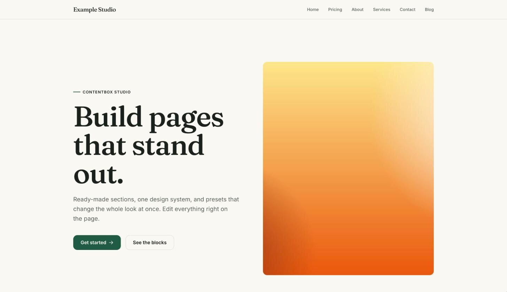
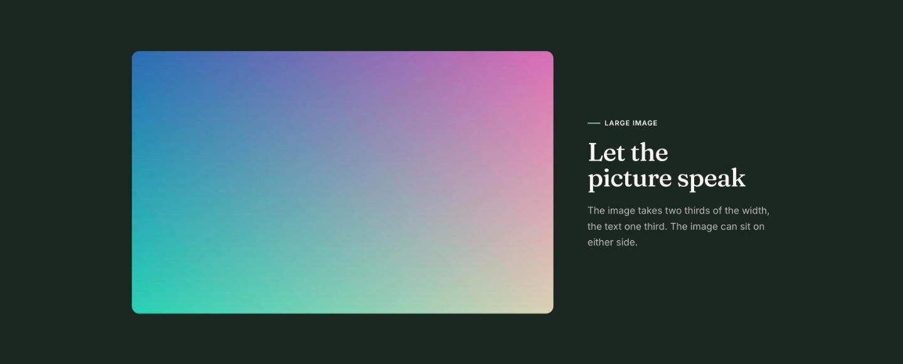
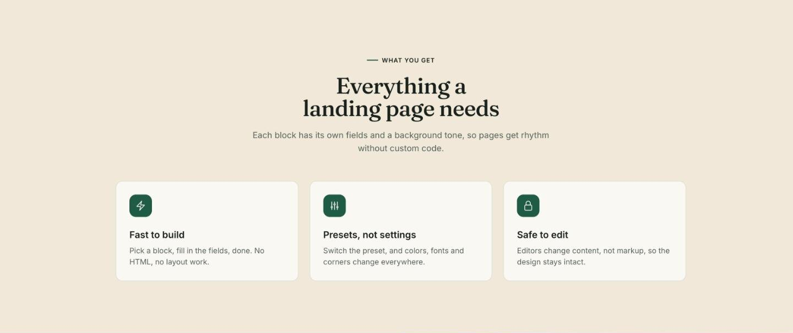
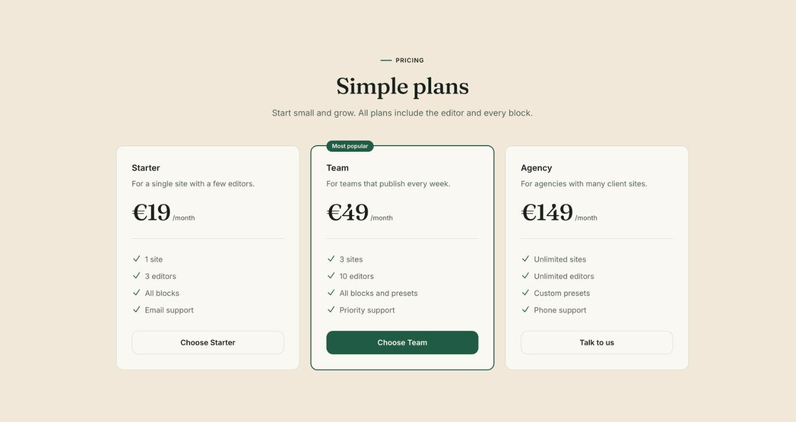
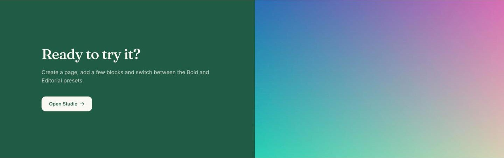
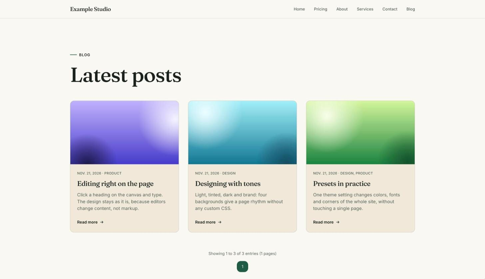

# Blocks

The blocks of Studio Starter as editors see them in [ContentBox Studio](https://github.com/akitogo/contentbox-studio).
Each section block has a **Background** (tone): Light, Light tinted, Dark or Brand color; text, lines and buttons inside
follow it (see [Customizing](customizing.md#tones)). The screenshots use the Editorial preset.

Fields marked * are required. Text fields that the block shows unchanged can also be edited directly on the page in
Studio's editor.

## Hero

The opening section of a page, from HyperUI's banner "Left with image". Pages only.

| Field | Type | |
|---|---|---|
| Label above the heading | text | the small line with a dash, e.g. the product name |
| Heading * | text with line breaks | large display type; line breaks are kept |
| Intro | text with line breaks | |
| Main button, Main button link | text, link | filled button; shown when both are set |
| Second button, Second button link | text, link | outlined button |
| Image | image | on the right; without one the text uses the full width |
| Background | Light, Light tinted, Dark, Brand color | default Light |

## Content with image

Heading, rich text, an optional button and an image, from HyperUI's marketing sections. Any content.

| Field | Type | |
|---|---|---|
| Label above the heading, Heading | text | |
| Text | rich text | paragraphs, lists, links, emphasis |
| Button, Button link | text, link | |
| Image | image | |
| Layout | Text and image, same width; Large image, narrow text; Large text, narrow image; Image below the text | |
| Image | Right, Left | which side, for the side-by-side layouts |
| Background | Light, Light tinted, Dark, Brand color | default Light |

## Features

A heading with intro and a grid of features, from HyperUI's feature grid "Grid with content". Any content.

| Field | Type | |
|---|---|---|
| Label above the heading, Heading | text | |
| Intro | text with line breaks | |
| Features | list | each with **Icon** (bolt, lock, sliders or none), **Title** * and **Text** |
| Columns | 2, 3 | default 3 |
| Background | Light, Light tinted, Dark, Brand color | default Light |

## Pricing

Plans with price, description, features and a button, from HyperUI's pricing "Options with tier, description, price,
call to action and features". Pages only.

| Field | Type | |
|---|---|---|
| Label above the heading, Heading | text | |
| Intro | text with line breaks | |
| Plans | list, up to four | each with **Name** *, **Description**, **Price** (e.g. €49), **Per** (e.g. month), **Included** (one feature per line), **Button** and **Button link**, **Highlight this plan** |
| Label of the highlighted plan | text | default "Most popular" |
| Background | Light, Light tinted, Dark, Brand color | default Light |

## Call to action

A heading, text and a button, with an optional image on the right, from HyperUI's CTA "Base with content and call to
action on the left, image on the right". Any content.

| Field | Type | |
|---|---|---|
| Heading * | text | |
| Text | text with line breaks | |
| Button, Button link | text, link | |
| Image | image | fills the right half |
| Background | Light, Light tinted, Dark, Brand color | default Brand color |

## Text and Heading

The theme replaces Studio's core blocks **Text** (rich text: paragraphs, headings, lists, quotes, links, emphasis)
and **Heading** (text, level 2 to 4) with its own templates: same fields, so content made with Studio's versions keeps
working, but in the theme's typography and a reading column. Use them for running text between sections, and in blog
posts.

## Studio's other blocks

Image, Gallery, Quote, Button, Content store item and HTML come from Studio itself, with Studio's base styles (the
theme's colors and fonts apply).

## Blog

Not a block, but part of the theme: the blog list shows posts as cards (the featured image, or a brand-colored panel
with the category), with date, categories and the excerpt (or the meta description). Category and search results use
the same cards, with ContentBox's paging in the theme's look. A post shows its categories, featured image and its
blocks or text; in Studio, its header (title, date, author, categories, image) appears above the blocks while
editing.
