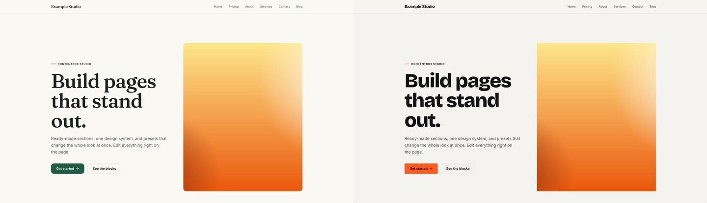

# Customizing Studio Starter

## Presets

A preset sets the whole look: colors, fonts, heading style and corner radius. The site picks one in the theme settings
(**Design preset**); every page and Studio's editor follow at once. Studio Starter has two:

| Preset | Look |
|---|---|
| **Bold** | warm off-white and near-black, a signal orange, a heavy grotesque (Bricolage Grotesque) for headings, nearly square corners |
| **Editorial** | paper white and deep green, a soft serif (Fraunces) for headings, rounded corners |

Body text uses Inter in both. The fonts are self-hosted, so no visitor data goes to a font service.

### Making your own preset

1. Copy `src/presets/editorial.css` to `src/presets/<name>.css` and change the values:

   | Variable | What |
   |---|---|
   | `--ss-paper`, `--ss-paper-alt` | backgrounds of light and light tinted sections |
   | `--ss-night`, `--ss-night-alt` | backgrounds of dark sections |
   | `--ss-ink`, `--ss-ink-soft` | text and secondary text on light backgrounds |
   | `--ss-snow`, `--ss-snow-soft` | text and secondary text on dark backgrounds |
   | `--ss-brand`, `--ss-brand-ink` | brand color (buttons, accents, brand sections) and the text on it |
   | `--ss-brand-dark`, `--ss-brand-dark-ink` | brand color on dark sections, light enough to stand out there |
   | `--ss-font-display`, `--ss-font-body` | font stacks of headings and body text |
   | `--ss-display-weight`, `--ss-display-tracking`, `--ss-display-leading` | weight, letter spacing and line height of headings |
   | `--ss-radius` | corner radius of boxes, buttons and images |

2. In `scripts/build-presets.mjs`, add the preset to `PRESETS` with its fonts (ids of
   [Fontsource variable fonts](https://fontsource.org), installed with `npm install -D @fontsource-variable/<id>`).
3. In `Theme.cfc`, add it to the options of the `preset` setting and to `this.presets`.
4. `npm run build`, then rebuild the theme registry in ContentBox's admin (**Look & Feel → Themes**) so the new option
   shows, and choose it in the theme settings.

Check the contrast of `--ss-brand` against `--ss-paper` and of `--ss-brand-dark` against `--ss-night`: buttons and
links use them.

## Tones

Every section block has a **Background**: Light, Light tinted, Dark or Brand color. The tone sets the colors for
everything inside the section, so text, lines and buttons stay readable without other settings. Alternating tones
give a page rhythm; the [blocks](blocks.md) show each of them.

Technically, a tone is a class on the section (`tone-light`, `tone-alt`, `tone-dark`, `tone-brand`) that maps the
preset's values to the colors the templates use (`src/theme.css`).

## Header, menu and footer

- **Header:** the site name, the site's main menu (ContentBox's pages that are in the menu, first level), **Blog** when
  the site's blog is on, and an optional button on the right (theme settings **Header button** and **Header button
  link**). On small screens the menu folds into a button.
- **Footer:** the site name, its tagline (ContentBox site settings), the same links, and the copyright line.
- Which pages appear in the menu is set per page in Studio (**Menu** switch) or in the classic admin.

## Theme settings

In ContentBox's admin, **Look & Feel → Themes**, settings of Studio Starter (per site):

| Setting | Default | |
|---|---|---|
| Design preset | Bold | the look of the whole site |
| Language | `en` | the `lang` of the pages, e.g. `de` |
| Heading of the blog | Latest posts | above the list of posts |
| Header button, Header button link | (empty) | an optional button in the header, e.g. Contact and `/contact` |

## Your own blocks

Add a folder to `blocks/` with a `block.json` and a `render.cfm`; Studio's
[guide to theme blocks](https://github.com/akitogo/contentbox-studio/blob/main/docs/theme-blocks.md) describes the
format. To fit in with the other blocks:

- give the block a `tone` select (light, alt, dark, brand) and put `tone-#args.data.tone#` on its section;
- use the theme's semantic classes (`bg-surface`, `bg-surface-alt`, `text-ink`, `text-muted`, `border-line`,
  `bg-brand`, `text-brand-ink`, `rounded-box`) and utilities (`heading`, `eyebrow`, `btn`, `btn-primary`,
  `btn-secondary`), never fixed colors, so presets and tones apply;
- write class names out in full (map values to classes, `{ "2": "md:grid-cols-2" }`), so Tailwind finds them;
- icons are in `blocks/_shared/icons.cfm` (Heroicons).

Then `npm run build` and re-render the site's content, see the [readme](../readme.md#build).

## Copying the theme

To change the theme for one site, copy the folder under a new name (the folder name is the theme's name in
ContentBox). Theme settings are stored per theme name, so a copy starts with its defaults.
