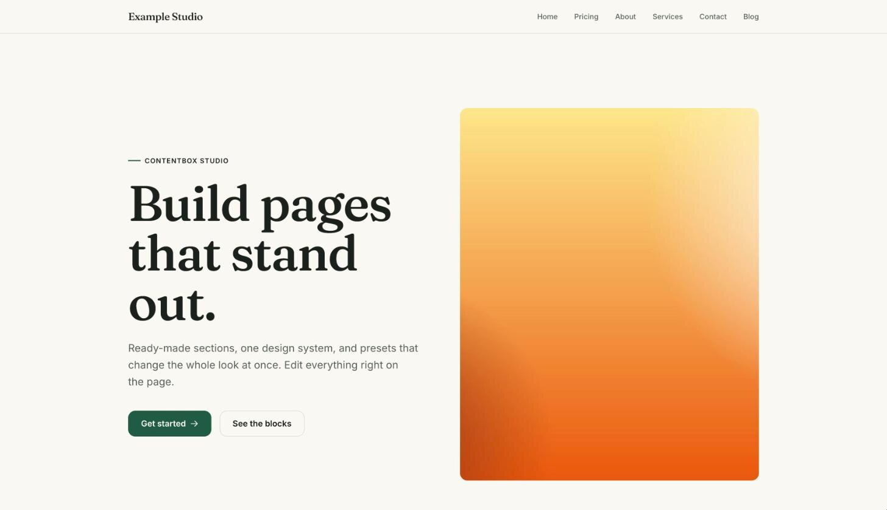
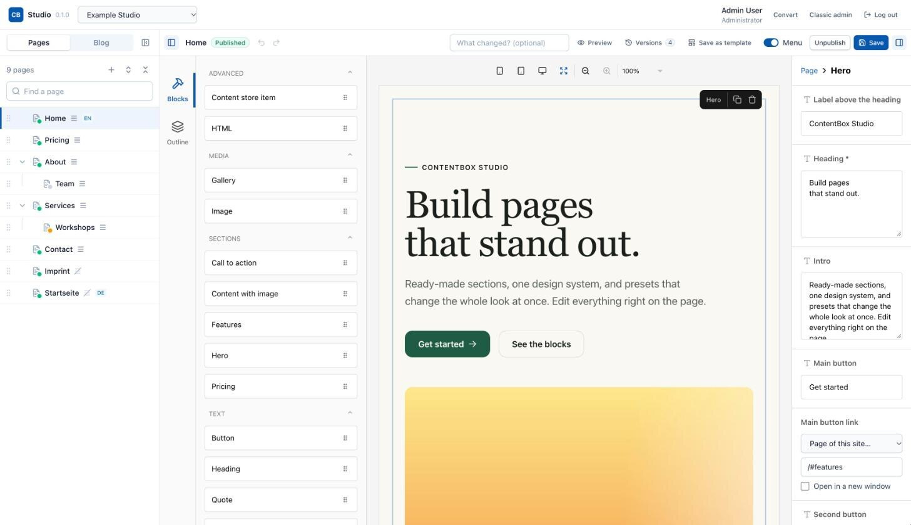

# Studio Starter

A ContentBox 7 theme with ready-made blocks for [ContentBox Studio](https://github.com/akitogo/contentbox-studio),
built with Tailwind CSS from [HyperUI](https://www.hyperui.dev)'s marketing components. One set of blocks, several
looks: a design preset switches colors, fonts and corners for the whole site.



Status: 0.1.0, the first version (five section blocks, two presets, blog), on
[ForgeBox](https://forgebox.io/view/studio-starter).

| Documentation | |
|---|---|
| [Blocks](https://github.com/akitogo/studio-starter/blob/main/docs/blocks.md) | Every block with a screenshot and its fields |
| [Customizing](https://github.com/akitogo/studio-starter/blob/main/docs/customizing.md) | Presets (and making your own), tones, header and footer, theme settings, your own blocks |

## Requirements

- ContentBox 7.
- [ContentBox Studio](https://github.com/akitogo/contentbox-studio) to edit pages with the blocks. Without Studio the
  theme still works as a ContentBox theme: content written in the classic editor appears in a reading column.
- No Node.js on the server: the built CSS and the fonts are part of the theme.

## Installation

In the root of the ContentBox site:

```bash
box install studio-starter
```

It goes to `modules_app/contentbox-custom/_themes/studio-starter`. Without CommandBox, clone or unpack it there:

```bash
git clone https://github.com/akitogo/studio-starter.git modules_app/contentbox-custom/_themes/studio-starter
```

Keep the folder name `studio-starter`: ContentBox stores the theme settings under it. Then, in ContentBox's admin:

1. **Look & Feel → Themes**, **Rebuild Registry**, and activate **Studio Starter** for the site.
2. Choose a **Design preset** in its settings (see [Customizing](https://github.com/akitogo/studio-starter/blob/main/docs/customizing.md#theme-settings)).
3. If the site already has content made with Studio's Text and Heading blocks, re-render it once, so it uses the
   theme's versions of them (see [Build](#build)).

## What is in it

| Part | |
|---|---|
| Section blocks (`blocks/`) | **Hero** (heading, intro, two buttons, optional image), **Content with image** (rich text, button, image side by side in three widths or below the text), **Features** (grid with icon, title, text), **Pricing** (up to four plans with price, features, button; one highlighted), **Call to action** (heading, text, button, optional image) |
| Core blocks | **Text** and **Heading** replace Studio's core blocks of the same name (same fields, so existing content keeps working) with the theme's typography in a reading column |
| Tones | Every section block has a background: light, light tinted, dark or brand color. Everything inside (text, lines, buttons) follows |
| Presets | **Bold** (grotesque headings, signal orange, square corners) and **Editorial** (serif headings, deep green, rounded corners); theme setting *Design preset*. A preset has its own brand color for dark sections, so accents stay visible there |
| Blog | List as cards (featured image or a brand-colored panel with the category, date, categories, excerpt or meta description), category and search views, ContentBox's paging in the theme's look; post view with categories, featured image and the post's blocks or text |
| Layout | Header with site name, main menu (ContentBox menu, plus Blog when the blog is on) and optional button; dark footer with the same links |
| Classic content | Pages without blocks get a title and a reading column with Tailwind Typography |
| Studio's editor | `blocks/_canvas/entry.cfm`: the header of a blog entry above its blocks while editing (same as on the post page); `blocks/editor.css`: the page background, font and text color in the editor canvas |

Not yet: comments on posts (ContentBox's comment form comes with Bootstrap markup), a blog teaser block (blocks render
when saved, so a list of the latest posts needs a ContentBox widget instead).

## In Studio's editor



The editor's canvas loads the theme's stylesheets, so blocks look as they do on the site. `blocks/editor.css` gives the
canvas the page background, font and text color of the layout, and `blocks/_canvas/entry.cfm` shows a blog post's
header above its blocks while editing.

## How the styling works

- `src/theme.css` is the Tailwind entry. Templates use only semantic colors (`bg-surface`, `text-ink`, `text-muted`,
  `border-line`, `bg-brand`, `text-brand-ink`), `rounded-box`, and a few utilities of the theme (`heading`, `eyebrow`,
  `btn`, `btn-primary`, `btn-secondary`).
- A preset (`src/presets/<name>.css`) defines raw values only (`--ss-paper`, `--ss-ink`, `--ss-brand`, fonts, radius,
  heading weight). The tone classes map them to the semantic colors, so a section can be light, dark or brand
  colored without other classes.
- The layout links the preset's stylesheet before the theme's. Both are `<link>`s, so Studio's editor canvas loads them
  too and shows blocks exactly as the site does.
- Fonts are self-hosted (no requests to font services), with their licenses next to them.

## Build

Sites need no Node: the built CSS and fonts are part of the theme. After changing templates or styles:

```bash
npm ci
npm run build    # presets with fonts, then Tailwind (scans blocks/, layouts/, views/)
```

The layout adds each stylesheet's modification time to its address (`theme.css?v=…`), so browsers load the new CSS at
once. Then re-render the content in Studio (`POST /cbstudio/api/blocks/rerender`, or save the pages), because block HTML
is rendered when content is saved.

Class names must appear complete in the templates for Tailwind to find them: map values to full names
(`{ "2": "md:grid-cols-2", "3": "md:grid-cols-3" }`), do not build them (`md:grid-cols-#n#`).

## ContentBox quirks the theme works around

- No theme setting is marked `required`: ContentBox 7 checks required theme settings under their plain names while the
  admin posts them as `cb_theme_<theme>_<name>`, so the settings form could never be saved.
- ContentBox caches whole pages and does not clear them when theme settings are saved; `Theme.cfc` listens to
  `cbadmin_postThemeSettingsSave` and clears the page caches, so a new preset shows at once.

## License

Apache License 2.0, by Akitogo Internet and Media Applications GmbH. Third-party material (HyperUI, Heroicons,
Tailwind CSS, fonts): see [THIRD-PARTY.md](https://github.com/akitogo/studio-starter/blob/main/THIRD-PARTY.md).
